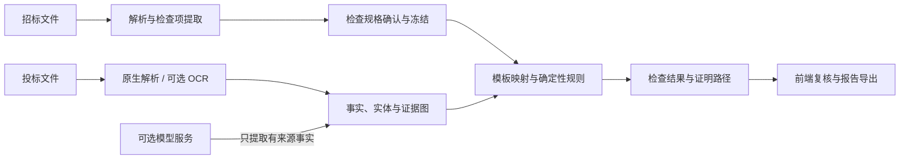

# BidCheck 实现思路与当前瓶颈

本文说明当前前后端、检查内核、证据存储、SQL 与部署的整体设计，并明确尚未解决的边界。具体运行方法和环境变量见 [`README.md`](README.md) 与 [`deploy/README.md`](deploy/README.md)。

## 1. 总体思路

BidCheck 当前生产主路径不让模型直接发布“通过/不通过”。系统先把招标要求保存为带版本、来源和参数的检查规格，再从投标材料中提取有原文依据的事实，最后由服务端模板与确定性规则计算结论。不能证明的部分保留为“待核验”或“系统未完成”，交给人工复核。

这条链路遵循四个原则：

1. 要求、事实、结论分层保存，避免把招标条款或模型文本直接当成程序规则。
2. 每个关键事实保留文档版本、页码/位置、原文、哈希与实体关系，结论可回溯。
3. 规则由代码和版本化模板拥有；当前模板/Focused 主路径中的模型只做受约束的 `EXTRACT`，不能生成规则、程序代码或业务结论。
4. 在模板依赖图路径中，资料或检查规格变化后可只重算受影响节点；关键证据操作通过稳定键、缓存或数据库租约减少重复请求。

## 2. 前端与 API

前端位于 `backend/src/main/resources/static/`，不需要单独的 Node 构建流程，随 Spring Boot JAR 一起发布。界面负责：

- 创建项目并上传招标文件、投标文件及补充材料。
- 查看、编辑、确认检查项，并冻结本次检查使用的规格版本。
- 展示业务事项、关键子项、来源范围、自动结论、证据和人工复核状态。
- 区分风险、证据不足、系统未完成和需要用户操作，避免把未知状态展示成通过。
- 导出 HTML、CSV、JSON 报告。

HTTP 入口由 `ApiController`、`VerificationController` 和相关服务提供。默认监听 `127.0.0.1`，请求过滤器同时要求来源地址和 Host 为本机回环，并校验浏览器 `Origin` 的协议、主机和端口。当前定位是本机单用户工作台，远程 UI 默认不受支持；远程化需要同机回环反向代理、经过审计的 Origin 处理或代码级受信外部 Origin 配置，以及认证和 TLS，不能把应用端口直接开放到内网或公网。

## 3. 检查规格与确定性规则

`checktemplate` 包是检查规格层：

- `CheckSpec` 保存模板、版本、主体选择器、参数、适用条件、证明标准和来源引用。
- `CheckSpecificationStoreService` 保存规格修订、确认状态与冻结快照，运行期间不读取后来被修改的草稿。
- `CheckTemplateRegistry` 从 `check-templates/core-templates.json` 加载版本化元数据，并只绑定到代码允许列表中的执行器。
- `RequirementMappingService` 把要求片段映射到当前 19 类模板；`DeterministicRequirementCompiler` 再生成封闭的规则树。
- `CoreTemplateEvaluators` 和 `RuleEvaluator` 负责金额、日期、数量、主体、人员、证书、承诺、联合体、方案维度等可程序化判断。

未知参数、未知模板、来源覆盖不全或新型条款不会被静默忽略。系统会保存未覆盖片段和原因码，并显示为待核验/系统未完成。

## 4. 文档、OCR 与模型边界

`FileParser` 统一处理原生文档内容、页面、表格和图片。PDFBox、Apache POI 负责可直接读取的内容；Aspose.Words 是可选的 DOCX 渲染增强；结构化 OCR 位于 `scripts/structured_ocr/`。

处理顺序是：

1. 优先使用原生文字、表格和已有坐标。
2. 仅对缺少文字或结构证据的页面启用可选 OCR/布局补识别。
3. 当前核验主路径的 `VerificationModelClient` 只接受严格 JSON 的事实提取请求，并限制字段、来源数量、数据类型与上下文范围。
4. 跨页面、跨资料的关系由服务端按实体、来源和版本汇合；模型输出不能直接证明全文件完整性。
5. 比较、计算、有效期、完整性与最终状态由程序执行。

外部 OCR、视觉和文本模型默认关闭。启用后，所选原文或图像可能发送给服务商并产生费用。代码中仍保留旧版 `SemanticChecker` 协议以兼容历史结构，但当前 `BidService` 不再把它作为未映射检查项的通用结论兜底；未映射语义项会明确返回上下文不可用/系统未完成。

## 5. 证据图与增量复用

关系化事实层把数据拆成实体、事实出现、证据、实体关系和事实—证据关系。`EvidenceGraphService` 为一次资料修订生成不可变证据图；运行只读固定修订，避免检查过程中证据漂移。

文本事实、视觉、外部查询等关键证据操作使用由输入哈希、文档版本、模型身份和操作类型组成的稳定键。`EvidenceOperationRepository` 使用数据库租约完成跨线程、跨进程 single-flight；普通 OCR 另有页结果复用和进程内并发控制。两类机制共同减少重复调用，但并不覆盖仓库中的每一种处理路径。

在模板依赖图及兼容恢复路径中，资料、检查规格或证据图变化后，依赖索引可定位受影响检查项。没有变化的证据和结论可以复用，变化的节点重新计算并生成候选修订；其他流程不能据此概括为都只重算受影响节点。

## 6. 持久化与 SQL

SQL 文件：

- [`backend/src/main/resources/schema.sql`](backend/src/main/resources/schema.sql)：H2。
- [`backend/src/main/resources/schema-mysql.sql`](backend/src/main/resources/schema-mysql.sql)：MySQL 8。

两份脚本维护同一组核心表：

| 表 | 用途 |
| --- | --- |
| `qc_record` | 项目、文档、检查规格、检查结果等版本化 JSON 记录 |
| `qc_task` | 持久任务、状态、重试、租约与心跳 |
| `qc_evidence_operation_lease` | OCR/模型等昂贵操作的分布式租约 |
| `qc_entity` | 人员、企业、项目、证书等实体 |
| `qc_fact_occurrence` | 带来源和版本的原子事实出现 |
| `qc_evidence` | 页面、原文、坐标、哈希等证据 |
| `qc_entity_link` | 实体、事实与关系的绑定 |
| `qc_fact_evidence` | 事实到证据的多对多映射 |

本地 profile 使用文件型 H2。`vm` profile 使用 MySQL，并可通过 RabbitMQ 发送任务就绪通知、通过 MinIO 保存原始文件；任务状态、租约和恢复仍以数据库为准，应用也保留本地工作目录中的完整原件副本/缓存。Spring 启动时执行对应建表脚本。

## 7. 部署结构

`deploy/compose.yml` 只管理三个中间件：MySQL、RabbitMQ、MinIO。Java 应用独立运行，通过环境变量连接它们。

- MySQL 保存业务记录、任务、事实和证据索引。
- RabbitMQ 只承担任务就绪通知；数据库租约仍是任务归属和恢复依据。
- MinIO 保存上传原件 `documents/{uuid}/original.bin`，数据库保存引用和元数据；报告由 API 即时生成，不写入 MinIO。成功上传后，应用的 `BIDCHECK_DATA/files` 仍保留完整本地副本/缓存，也必须纳入备份与容量规划。
- 中间件不可用时，系统应保留明确失败/待恢复状态，不能把基础设施失败转成业务不合格。

该 Compose 是单虚拟机方案，只提供持久化与进程自动重启，不提供节点冗余或自动故障转移。

## 8. 当前瓶颈

### 8.1 规则覆盖仍是有限集合

当前 19 类模板覆盖常见人员、证书、金额、期限、承诺、联合体和方案等要求，但招标条款可以不断出现新的写法和业务类型。新类型需要补充模板、参数提取、证据契约和确定性执行器。系统目前选择明确显示“系统未完成”，不会用模型临时编造规则；安全性更高，但覆盖扩展仍需要研发。

### 8.2 扫描件与复杂版式

低清扫描、旋转页、跨页表格、合并单元格、盖章遮挡和 Word 渲染差异仍会降低证据定位质量。OCR 能补文字但不天然证明表格关系；Aspose.Words 的完整渲染还依赖合法许可证。复杂文档仍需抽样核对原图。

### 8.3 完整性与反证成本

证明“存在”通常只需一个可靠证据，证明“不存在”“唯一”“全部一致”则需要确认完整来源范围。只要页面、附件或 OCR 覆盖不完整，系统必须保持未知状态。这是业务证明边界，不应通过降低阈值规避。

### 8.4 外部模型的延迟、成本与隐私

模型只提取事实后，误生成结论的风险已降低，但漏提、格式错误、超时和限流仍可能发生。大文件会放大调用次数、等待时间和费用；当前自动核验的 `max-model-calls` 参数不会形成总调用硬上限，Focused/OnDemand 与默认一致性路径也没有总金额或总 token 预算。敏感文档还需要独立的数据出境、保留期限和供应商合规评估。

### 8.5 增量复用增加了版本治理复杂度

证据键、模板版本、文档版本、模型身份和依赖图必须保持稳定。任何身份计算错误都可能造成错误复用或无效重复计算。当前使用哈希、不可变修订、租约和回归测试约束，但仍需要运行指标、租约清理、容量规划和长期数据归档策略。

### 8.6 数据库迁移还未版本化

当前 SQL 以幂等建表/补列为主，尚未接入 Flyway 或 Liquibase。H2 到 MySQL 也不是自动迁移：目标库须先用完整 MySQL schema 初始化，现有迁移工具只复制 `qc_record`、`qc_task` 和原件。随着表结构继续演进，需要引入带版本、可回滚、可审计的数据库迁移流程。

### 8.7 部署仍是单节点

当前方案没有多租户身份认证、内置 TLS、高可用数据库、RabbitMQ/MinIO 集群、Java 进程托管或自动异机备份。`LocalRequestFilter` 还要求请求来源和 Host 都是本机回环，并校验浏览器 Origin；仅增加同机反向代理和重写 Host 不足以支持远程 UI，还需审计 Origin 策略或增加显式受信外部 Origin 配置。应用端口不能直接开放到内网或公网。当前应用直接使用 MinIO root 凭据，RabbitMQ/MinIO 连接也是受控私网内的明文协议。MinIO 镜像要求服务器预先缓存，并通过 `pull_policy: never` 避免未审计换版，但 `latest` 标签本身不可复现。生产化仍需最小权限服务账号、认证授权、代理层 TLS、固定镜像摘要、systemd/容器化托管、监控告警、异机备份和恢复演练。

### 8.8 公开回归与真实场景验收存在差距

公开仓库不包含真实标书、个人/企业资料及其冻结回归快照，因此外部 CI 只能运行合成和脱敏测试。自动测试能证明程序契约，但不能代表所有行业、地区和版式的识别准确率；每次重要规则或 OCR 变更仍需要在有权限的隔离环境进行端到端验收。

### 8.9 吞吐、数据生命周期与可观测性

当前任务执行器固定为 2 个 worker，RabbitMQ consumer 和预取量也面向单节点低并发。证据图以整份 JSON 快照保存并在内存中遍历，部分列表缺少完整的服务端分页；它不适合直接扩展为大型多租户语料服务。项目、文档、对象和快照尚无完整的删除、保留期、对象垃圾回收及归档流程，事务失败还可能留下孤立文件。`/api/health` 只表示应用可响应，不检查数据库、队列、对象存储或外部模型；处理指标也只在当前进程内累计。

### 8.10 代码与交付维护成本

前端使用体积较大的原生脚本并依赖轮询，后端的文档解析、证据组装和核心服务类也承担了较多职责。仓库尚未提供 GitHub Actions 等公共 CI。继续扩展模板和文档格式前，需要拆分模块、建立公共合成基准，并在私有隔离环境保留真实材料回归，两套验证不能互相替代。

## 9. 建议的下一步

1. 为 SQL 引入 Flyway/Liquibase，并建立 H2→MySQL 的可重复迁移与回滚测试。
2. 固定所有部署镜像的版本或 digest，补齐 TLS、认证、监控和异机恢复演练。
3. 为未知条款建立脱敏样本库和模板扩展流程，以“覆盖率 + 未覆盖原因”衡量进展。
4. 增加 OCR 页面级质量指标、人工抽检队列和复杂表格专项基准。
5. 为模型调用增加按任务的调用量、token 与费用硬预算，并建立失败率、证据复用率、租约超时和数据增长监控。
6. 补齐数据保留、删除、对象垃圾回收和孤立文件修复机制。
7. 在授权的隔离环境完成最新版本端到端真实材料验收，并只发布脱敏后的统计结论。
