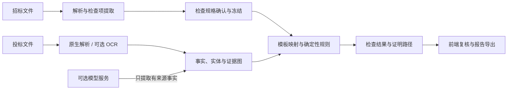

# BidCheck 实现思路与当前瓶颈

本文说明当前前后端、检查内核、证据存储、SQL 与部署的整体设计，并明确尚未解决的边界。具体运行方法和环境变量见 [`README.md`](README.md) 与 [`deploy/README.md`](deploy/README.md)。

## 1. 总体思路

BidCheck 当前生产主路径不让模型直接发布“通过/不通过”。系统先把招标要求保存为带版本、来源和参数的检查规格，再从投标材料中提取有原文依据的事实，最后由服务端模板与确定性规则计算结论。不能证明的部分保留为“待核验”或“系统未完成”，交给人工复核。

这条链路遵循四个原则：

1. 要求、事实、结论分层保存，避免把招标条款或模型文本直接当成程序规则。
2. 每个关键事实保留文档版本、页码/位置、原文、哈希与实体关系，结论可回溯。
3. 规则由代码和版本化模板拥有；当前模板/Focused 主路径中的模型只做受约束的 `EXTRACT`，不能生成规则、程序代码或业务结论。
4. 在模板依赖图路径中，资料或检查规格变化后可只重算受影响节点；关键证据操作通过稳定键、缓存或数据库租约减少重复请求。

## 2. 前端与 API

前端位于 `backend/src/main/resources/static/`，不需要单独的 Node 构建流程，随 Spring Boot JAR 一起发布。界面负责：

- 创建项目并上传招标文件、投标文件及补充材料。
- 查看、编辑、确认检查项，并冻结本次检查使用的规格版本。
- 展示业务事项、关键子项、来源范围、自动结论、证据和人工复核状态。
- 区分风险、证据不足、系统未完成和需要用户操作，避免把未知状态展示成通过。
- 导出 HTML、CSV、JSON 报告。

HTTP 入口由 `ApiController`、`VerificationController` 和相关服务提供。默认监听 `127.0.0.1`，请求过滤器同时要求来源地址和 Host 为本机回环，并校验浏览器 `Origin` 的协议、主机和端口。当前定位是本机单用户工作台，远程 UI 默认不受支持；远程化需要同机回环反向代理、经过审计的 Origin 处理或代码级受信外部 Origin 配置，以及认证和 TLS，不能把应用端口直接开放到内网或公网。

## 3. 检查规格与确定性规则

`checktemplate` 包是检查规格层：

- `CheckSpec` 保存模板、版本、主体选择器、参数、适用条件、证明标准和来源引用。
- `CheckSpecificationStoreService` 保存规格修订、确认状态与冻结快照，运行期间不读取后来被修改的草稿。
- `CheckTemplateRegistry` 从 `check-templates/core-templates.json` 加载版本化元数据，并只绑定到代码允许列表中的执行器。
- `RequirementMappingService` 把要求片段映射到当前 19 类模板；`DeterministicRequirementCompiler` 再生成封闭的规则树。
- `CoreTemplateEvaluators` 和 `RuleEvaluator` 负责金额、日期、数量、主体、人员、证书、承诺、联合体、方案维度等可程序化判断。

未知参数、未知模板、来源覆盖不全或新型条款不会被静默忽略。系统会保存未覆盖片段和原因码，并显示为待核验/系统未完成。

2026-10-26 的三环节改造把普通检查接入可复用的确定性要求包。要求包绑定冻结招标来源、原文哈希、编译器版本和业务参数，复用时仍经过当前覆盖校验；缓存的是规则，不能缓存为“通过”。父级主体及 `ALL/ANY` 关系先保留，再生成子条件。例如设计资质的多条替代路径作为 `ANY`，查询截图等共通证明位于外层 `ALL`；未知换证路径保留为未知，不能删除后误判不满足。人数、合同数量和月份分别处理，旧工期条目也进入统一核验路径。

宽泛的“符合某章要求”保存为 `SUMMARY_OF` 引用依赖，不把整章内容复制进报价等单项规则。明确条号仍按原文位置解析。任意跨页自由条款的完整自动解析和宽泛引用的最终依赖聚合尚未完成，不能据此宣称所有复杂条款已可执行。

资质条款的共通证明关联到实际满足该资质路径的证书，比较单位、资质类别、证号和等级，并保留查询记录及网址来源。其他证书的截图不能补齐本证书的证明；没有可追溯关联时保留未完成。该核验比较所提供材料，不声称完成实时官方网站核验。

## 4. 文档、OCR 与模型边界

`FileParser` 统一处理原生文档内容、页面、表格和图片。PDFBox、Apache POI 负责可直接读取的内容；Aspose.Words 是可选的 DOCX 渲染增强；结构化 OCR 和本地补字均位于 Java `cn.bidcheck.ocr` 包。

处理顺序是：

1. 优先使用原生文字、表格和已有坐标。
2. 仅对缺少文字或结构证据的页面启用可选 OCR/布局补识别。
3. 当前核验主路径的 `VerificationModelClient` 只接受严格 JSON 的事实提取请求，并限制字段、来源数量、数据类型与上下文范围。
4. 跨页面、跨资料的关系由服务端按实体、来源和版本汇合；模型输出不能直接证明全文件完整性。
5. 比较、计算、有效期、完整性与最终状态由程序执行。

外部 OCR、视觉和文本模型默认关闭。启用后，所选原文或图像可能发送给服务商并产生费用。代码中仍保留旧版 `SemanticChecker` 协议以兼容历史结构，但当前 `BidService` 不再把它作为未映射检查项的通用结论兜底；未映射语义项会明确返回上下文不可用/系统未完成。

## 5. 证据图与增量复用

关系化事实层把数据拆成实体、事实出现、证据、实体关系和事实—证据关系。`EvidenceGraphService` 为一次资料修订生成不可变证据图；运行只读固定修订，避免检查过程中证据漂移。

文本事实、视觉、外部查询等关键证据操作使用由输入哈希、文档版本、模型身份和操作类型组成的稳定键。`EvidenceOperationRepository` 使用数据库租约完成跨线程、跨进程 single-flight；普通 OCR 另有页结果复用和进程内并发控制。两类机制共同减少重复调用，但并不覆盖仓库中的每一种处理路径。

在模板依赖图及兼容恢复路径中，资料、检查规格或证据图变化后，依赖索引可定位受影响检查项。没有变化的证据和结论可以复用，变化的节点重新计算并生成候选修订；其他流程不能据此概括为都只重算受影响节点。

普通检查新增两项基础能力：

- **规范事实查询。** `CanonicalFactLookup` 在现有 `qc_record` 中保存唯一事实及来源、类型、字段索引；采用某条事实的次数只增加审计记录，不再增加检索候选。正常查询不回读全部历史批次或完整采用历史。历史数据分批建立索引，状态为 `BUILDING/READY/BLOCKED`；未完成或损坏时保留旧查询回退。多来源依赖、文档版本、来源指纹和冲突保护仍须通过。事实结果达到数量上限时明确记录覆盖不完整，不能以被截断的集合证明通过。
- **普通运行内的依赖补查。** `OrdinaryRecoveryDependencies` 记录条件读取版本和需要的事实。新增匹配字段或主体关系后，只重新排队受影响的阻塞事项，并带入该证据的完整来源链。同一变化只调度一次；无关关系、采用历史、重复回执和退役规则不会反复触发。`RecoveryDependencyGate` 在昂贵查询前识别输入未变化的无效重试；没有可信事实版本时保守执行。补查仍重新核验完整证明树，调度事件本身不产生业务结论。

文本提取缓存使用独立的提取契约版本，不再因业务引擎版本或请求超时设置变化而整体失效；原文、模型、提取协议或来源版本变化仍会失效。此机制复用经过来源校验的事实，不复用未经重算的通过结论。OCR、混合检索和来源校验保持原有责任边界。

运行日志按 `REQUIREMENT_COMPILATION`、事实查询/迁移、`recovery_change`、`recovery_dependency_schedule` 和无变化终止分阶段记录，可追踪编译缺口、查库规模、事实版本及触发条件。日志中不增加原文、人员姓名或模型凭据。

## 6. 持久化与 SQL

SQL 文件：

- [`backend/src/main/resources/schema.sql`](backend/src/main/resources/schema.sql)：H2。
- [`backend/src/main/resources/schema-mysql.sql`](backend/src/main/resources/schema-mysql.sql)：MySQL 8。

两份脚本维护同一组核心表：

| 表 | 用途 |
| --- | --- |
| `qc_record` | 项目、文档、检查规格、检查结果等版本化 JSON 记录 |
| `qc_task` | 持久任务、状态、重试、租约与心跳 |
| `qc_evidence_operation_lease` | OCR/模型等昂贵操作的分布式租约 |
| `qc_entity` | 人员、企业、项目、证书等实体 |
| `qc_fact_occurrence` | 带来源和版本的原子事实出现 |
| `qc_evidence` | 页面、原文、坐标、哈希等证据 |
| `qc_entity_link` | 实体、事实与关系的绑定 |
| `qc_fact_evidence` | 事实到证据的多对多映射 |

本地 profile 使用文件型 H2。`vm` profile 使用 MySQL，并可通过 RabbitMQ 发送任务就绪通知、通过 MinIO 保存原始文件；任务状态、租约和恢复仍以数据库为准，应用也保留本地工作目录中的完整原件副本/缓存。Spring 启动时执行对应建表脚本。

## 7. 部署结构

`deploy/compose.yml` 只管理三个中间件：MySQL、RabbitMQ、MinIO。Java 应用独立运行，通过环境变量连接它们。

- MySQL 保存业务记录、任务、事实和证据索引。
- RabbitMQ 只承担任务就绪通知；数据库租约仍是任务归属和恢复依据。
- MinIO 保存上传原件 `documents/{uuid}/original.bin`，数据库保存引用和元数据；报告由 API 即时生成，不写入 MinIO。成功上传后，应用的 `BIDCHECK_DATA/files` 仍保留完整本地副本/缓存，也必须纳入备份与容量规划。
- 中间件不可用时，系统应保留明确失败/待恢复状态，不能把基础设施失败转成业务不合格。

该 Compose 是单虚拟机方案，只提供持久化与进程自动重启，不提供节点冗余或自动故障转移。

## 8. 当前瓶颈

### 8.1 规则覆盖仍是有限集合

当前 19 类模板覆盖常见人员、证书、金额、期限、承诺、联合体和方案等要求，但招标条款可以不断出现新的写法和业务类型。新类型需要补充模板、参数提取、证据契约和确定性执行器。系统目前选择明确显示“系统未完成”，不会用模型临时编造规则；安全性更高，但覆盖扩展仍需要研发。

### 8.2 扫描件与复杂版式

低清扫描、旋转页、跨页表格、合并单元格、盖章遮挡和 Word 渲染差异仍会降低证据定位质量。OCR 能补文字但不天然证明表格关系；Aspose.Words 的完整渲染还依赖合法许可证。复杂文档仍需抽样核对原图。

### 8.3 完整性与反证成本

证明“存在”通常只需一个可靠证据，证明“不存在”“唯一”“全部一致”则需要确认完整来源范围。只要页面、附件或 OCR 覆盖不完整，系统必须保持未知状态。这是业务证明边界，不应通过降低阈值规避。

### 8.4 外部模型的延迟、成本与隐私

模型只提取事实后，误生成结论的风险已降低，但漏提、格式错误、超时和限流仍可能发生。大文件会放大调用次数、等待时间和费用；当前自动核验的 `max-model-calls` 参数不会形成总调用硬上限，Focused/OnDemand 与默认一致性路径也没有总金额或总 token 预算。敏感文档还需要独立的数据出境、保留期限和供应商合规评估。

### 8.5 增量复用增加了版本治理复杂度

证据键、模板版本、文档版本、模型身份和依赖图必须保持稳定。任何身份计算错误都可能造成错误复用或无效重复计算。当前使用哈希、不可变修订、租约和回归测试约束，但仍需要运行指标、租约清理、容量规划和长期数据归档策略。

### 8.6 数据库迁移还未版本化

当前 SQL 以幂等建表/补列为主，尚未接入 Flyway 或 Liquibase。H2 到 MySQL 也不是自动迁移：目标库须先用完整 MySQL schema 初始化，现有迁移工具只复制 `qc_record`、`qc_task` 和原件。随着表结构继续演进，需要引入带版本、可回滚、可审计的数据库迁移流程。

### 8.7 部署仍是单节点

当前方案没有多租户身份认证、内置 TLS、高可用数据库、RabbitMQ/MinIO 集群、Java 进程托管或自动异机备份。`LocalRequestFilter` 还要求请求来源和 Host 都是本机回环，并校验浏览器 Origin；仅增加同机反向代理和重写 Host 不足以支持远程 UI，还需审计 Origin 策略或增加显式受信外部 Origin 配置。应用端口不能直接开放到内网或公网。当前应用直接使用 MinIO root 凭据，RabbitMQ/MinIO 连接也是受控私网内的明文协议。MinIO 镜像要求服务器预先缓存，并通过 `pull_policy: never` 避免未审计换版，但 `latest` 标签本身不可复现。生产化仍需最小权限服务账号、认证授权、代理层 TLS、固定镜像摘要、systemd/容器化托管、监控告警、异机备份和恢复演练。

### 8.8 公开回归与真实场景验收存在差距

公开仓库不包含真实标书、个人/企业资料及其冻结回归快照，因此外部 CI 只能运行合成和脱敏测试。自动测试能证明程序契约，但不能代表所有行业、地区和版式的识别准确率；每次重要规则或 OCR 变更仍需要在有权限的隔离环境进行端到端验收。

### 8.9 吞吐、数据生命周期与可观测性

当前任务执行器固定为 2 个 worker，RabbitMQ consumer 和预取量也面向单节点低并发。证据图以整份 JSON 快照保存并在内存中遍历，部分列表缺少完整的服务端分页；它不适合直接扩展为大型多租户语料服务。项目、文档、对象和快照尚无完整的删除、保留期、对象垃圾回收及归档流程，事务失败还可能留下孤立文件。`/api/health` 只表示应用可响应，不检查数据库、队列、对象存储或外部模型；处理指标也只在当前进程内累计。

### 8.10 代码与交付维护成本

前端使用体积较大的原生脚本并依赖轮询，后端的文档解析、证据组装和核心服务类也承担了较多职责。仓库尚未提供 GitHub Actions 等公共 CI。继续扩展模板和文档格式前，需要拆分模块、建立公共合成基准，并在私有隔离环境保留真实材料回归，两套验证不能互相替代。

## 9. 建议的下一步

1. 为 SQL 引入 Flyway/Liquibase，并建立 H2→MySQL 的可重复迁移与回滚测试。
2. 固定所有部署镜像的版本或 digest，补齐 TLS、认证、监控和异机恢复演练。
3. 为未知条款建立脱敏样本库和模板扩展流程，以“覆盖率 + 未覆盖原因”衡量进展。
4. 增加 OCR 页面级质量指标、人工抽检队列和复杂表格专项基准。
5. 记录按任务的调用量、token 与费用，建立失败率、证据复用率、租约超时和数据增长监控；按当前产品要求不以总调用预算截断尚未完成的检查。
6. 补齐数据保留、删除、对象垃圾回收和孤立文件修复机制。
7. 在授权的隔离环境完成最新版本端到端真实材料验收，并只发布脱敏后的统计结论。

## 10. 失败项驱动的修复

修复以隔离保存的冻结原文和原检查项 ID 验收，针对既有系统未完成项及设计资质链逐项记录来源、执行规则、已核源事实、决定和剩余缺口。离线回放禁止模型、OCR 和生产任务调用，也不能替代新的生产检测结果。完整验收数据属于私有隔离材料，未纳入公开仓库。

- **要求生成与恢复**：恢复来源、重新编译规则、只重算证据分别执行；编译器、来源恢复、映射和校验版本参与补查依赖。来源未变且没有新可执行能力时，不因重复调度宣称规则已修复。发布必须保留原义务及其必选/替代逻辑，不能通过删除条件、改成不适用或迁入可绕过的分支制造完成。
- **旧评分来源迁移**：仅对能唯一对应旧生成器身份、原文位置及摘要的记录恢复完整评分行，保留原检查项 ID 和已确认内容。设计/施工方案同时保留完整性公式与主观分档；职称评分要求同人、专业、证号及共同证明。只找到材料不能直接判最高档，找不到证书也不能直接算“未提交 0 分”。
- **证据复用与归属**：使用同一份经过原文校验的证书事实，按证号和唯一单位关联查询表行。历史合同范围只有在目录、实体页码和章节正文共同吻合时才结束。企业负责人、注册单位与劳动关系分别核验，姓名相同不能单独证明同人。证书有效日期晚于要求时点应输出风险，不因材料存在而通过。
- **本地明确响应**：当前项目投标函的质量、有效期，以及有明确适用条件的联合体协议/授权书正文，由本地程序核源读取。保留冻结文本扫描回执，避免再次付费提取相同文字。填写说明、空栏、目录、历史项目和其他单位不能提供通过依据；有效期天数与明确起算事件分别核对。
- **补查后的结论**：新来源校验或规则版本撤回的旧证明不能恢复为当前通过；旧结果可留作历史。仅有读取完成、编译完成或新增未知节点均不等于业务证明完成。
- **界面与日志**：分别展示承诺响应、材料提交、客观完整性核对和主观评分待评审；真实系统错误保留优先级。补查审计保存动作、规则/来源版本、失败原因和前后变化，证照关联日志记录计数及绑定状态，避免输出个人原文。

尚未闭合的能力包括合同及框架订单的金额口径聚合、历史人员业绩联合计分、额外人员计分、特殊社保证明、部分跨页同人证据和外部平台记录。源 OCR 乱码不能靠放宽身份校验修复，需要局部重新识别。以上缺口仍保留，不以状态改名宣称既有未完成项已全部解决。

## 11. 剩余事项的主流程修复

本次基于隔离保存的原运行和冻结文档修复，保留原业务事项 ID、OCR、混合检索与来源验证。下述能力通过主流程契约回归验证；离线冻结回放只读取已保存原文，不代表重新进行了 OCR 或完整生产检测。

### 11.1 要求编译与来源作用域

- 人员表格的制表符与冒号具有同等标题边界；共同社保义务只检查之前是否发生主体切换，后面的独立岗位资格段不再抹掉前面的共同主体。跨单位、跨标段或另一份人员集合仍禁止继承。
- 针对完整来源定义的联合体、保证金、文件签署权、逐表单签章、四类客观评分、承诺清单与外部事项接入专用执行器。来源没有完全对应闭合语法时继续保留缺口，不能只凭关键词跳过独立条件。
- “第三章 3.1”等总括引用形成当前运行中的依赖，不再复制整章要求，也不当成章节存在性检查。报价唯一的独立条件仍保留。
- 旧的“一个父规则包含多个分号必定未展开”保护改为核查专用执行器完整来源及参数重建。一般规则继续保留原保护，未知附加条件不能因父规则存在而消失。

### 11.2 证据对应和完整业务证明

- 同证书查询表行保留中文证号、证书号/注册号/执业印章号的字段类型；身份证号不再被误读为第二证书号。姓名与身份证只能在同记录明确标签、紧邻换行或已有强身份关系下关联。
- 登记要求整段保留投标人主体；营业执照在同一单证块内绑定单位、统一社会信用代码和营业期限，不套用资质证书号。原文笼统的“具备履约能力”尚未给出核验指标或认可的证明方式，显式保留“核验标准待明确”输入条件；本轮未实现无标准的履约能力自动核验，营业执照、未破产承诺不能代替该证明。
- 多专业证书分别保存使用期、各专业注册期，并按原要求专业选取。不能拿另一专业的有效期代替本项，也不能将 C2 自动当作 C3。设计资质查询链不能代替该证书的完整有效期证明。
- 保证金逐字段核对金额、缴款主体、收款账户、项目/标段和时间。付款日期不证明到账日期；付款承诺不证明已缴纳。未解析缴纳政策单独保留，日期证明以可序列化的原值保存。
- 联合体牵头、施工分工必须来自同一完整成员协议；协议提交、人员委派、成员数量分别判断。法定代表人直接签署免授权书有独立适用证明，不以授权书缺失自动认定免交。
- 客观业绩评分按同合同身份、签订日期、正确金额口径、共同证明去重。无金额框架合同只聚合同合同号下的订单；当前岗位与历史业绩人员须有身份关联。达到上限或完整申报清单逐项核完才发布确定分值，否则保留已证分值下限。企业“至今”以已核投标截止为本次投标统计边界的策略明确记录，不伪装成原句明确日期，也不用运行当天替代。
- 额外人员评分依赖本次基础配置完整结论和强身份排除，不把未识别基础人员当作新增人数；证书、查询与社保的共同条件仍须完整。

### 11.3 复用、补查和外部查询

- 无有效字段的规则不再进行共享事实的宽范围历史回查；同一检查项内重复采纳去重，跨检查项审计保留。租约申请去除同表 `INSERT SELECT` 竞争，瞬时数据库死锁只在无外层事务时重试租约申请，保留 owner token 与 fencing，不重复模型请求。
- 总括事项在子项补查结束后以同运行、同文档哈希/版本和同检查项快照重算，禁止新模型调用。未回放或未覆盖的子项不能借用历史通过。
- 同运行的 `PASS` 也必须具有当前来源证据和已完成的顶层条件，不能仅凭 `atomicCheck.complete=true` 被汇总或增员评分复用。业务专属依赖还须匹配基础要求范围及完整规则身份。
- 外部请求贯通固定提供方、原要求摘要与完整条件字段；连接器响应必须确认对应范围且每个覆盖字段有真实结果。仅有请求参数、历史截图或供应商声明不能证明实时状态。错误响应不能成为永久成功缓存，连接恢复后允许重试。
- 缺招标附件、现场阶段、外部查询故障、要求尚未展开分别路由；不存在新输入或新依赖结果时停止同样的重复补查。用户界面同步显示具体缺口，不把所有系统工作变为人工核对。

### 11.4 验证与仍需保留的边界

私有验收输出未纳入公开仓库。冻结回放编译全部原业务事项 ID，并重点回放既有系统未完成项及设计资质控制项；强断言检查目标项无空规则、无不可执行原语、无编译问题，并要求原文承诺清单完整。证书日期缺口不能再成为通过依据。

编译能够执行不等于业务证明已齐全。原文未提供的技术附件、未取得的外部/现场记录、签章位置原图、不能可靠关联的人员身份、没有闭合的申报清单以及总括项未完成依赖仍保留明确缺口。离线回放不复用历史模型结论、不能作为新的生产通过率或端到端耗时。

## 12. 受控 Java 查证与根因修复（2026-10-27；2026-11-03 Java 迁移）

### 12.1 执行位置与责任

`VerificationEngine` 的 `TARGETED_EVIDENCE` 阶段，在人员任职、人员证书关联、签署权事项仍有缺口时调用 JVM 内的 Java Agent。首次普通检查、已闭合事项、纯本地依赖重算继续由现有程序执行。查证失败恢复使用 `RETRY_FAILED_STEP`，保留原查证身份。调用身份包含实现策略、提供方端点和模型；不包含凭证或凭证哈希。

模型工具回环由 Java 8 实现，直接请求现有百炼兼容接口。原桥接的可信回执、调用许可和租约取消边界保留；没有 Python 生产进程或 Agents SDK 运行依赖。模型服务沿用百炼，显式限制 DashScope 域名并禁用重定向、环境代理与云端 tracing。

模型负责选取下一步证据工具；Java 负责文件版本隔离、来源验真、候选事实采纳与完整条件树重算。模型自然语言不能发布 PASS、修改要求或改变项目范围。每次模型请求先获得 Java 许可 ACK，再发往现有百炼。单次超时或异常留下系统失败，不转换为材料缺失；没有按业务事项数量设调用预算。

### 12.2 可调用的工具

| 工具 | 实际行为 | 边界 |
|---|---|---|
| `search_evidence` | 使用现有混合检索选择当前冻结文档来源，并执行原生事实提取 | 命中不代表通过；记录真实检索路线 |
| `read_section` | 按来源句柄顺序读取，可前后翻阅 | 截断返回 continuation，不把部分窗口当全文 |
| `read_table_record` | 读取版本绑定的表格行列，支持偏移续读 | 单元格仅辅助绑定，不自动继承人员身份 |
| `submit_candidate_fact` | `ProofVerifier` 校验原文、字段和来源后发布共享事实 | 候选 sourceId 必须已经实际返回；模型身份属性不作可信身份 |
| `recompute_check` | 用已接受事实重算原来的且、或、适用分支 | 只有程序可确认完整业务结论；完整结论也可能为风险 |
| `inspect_page_region` | 复用同版本、同位置、同字段的合法观察；否则登记原图补查请求 | 新请求由既有视觉队列执行，PENDING 不声称已识别 |
| `query_external` | 读取该检查已有的可信外部记录 | 新外部查询由既有受控队列执行，不接受模型提供的任意网址 |

原生检索、章节读取和候选提交产生的有效事实都会推进证据版本，使旧缓存及旧重算完成回执失效。重复且无新增证据的同一动作停止，避免无限循环。超时会使回调取消栅栏失效，持久化仍使用原有任务租约和版本保护。

### 12.3 本轮修复的业务链路问题

1. `PERSON_ROLE` 已经由岗位和来源约束其业务含义；原生事实的“姓名”标签不再因规则使用 `role` 而被过滤。历史任职、不同单位和身份冲突的保护继续生效。
2. 普通资质分支重新核对所选企业、类别、证号及当前字段，扫描同号反证。仅在该局部证明闭合时解除相同观察范围的来源审查依赖；共享查询截断、不同证书混拼、有效期缺失仍阻断。
3. 共通查询证明只能消费闭合收据实际选择的证书，避免先排除冲突证书、后又借用该证书。
4. 外部未配置、未执行、请求失败、无记录、阶段未到分别记录。没有新增外部证据时也保存诊断；诊断更新不记作业务重算。
5. `WAIT_EXTERNAL` 表示等待明确的外部阶段，未配置连接仍属 `SYSTEM_INCOMPLETE`。整体 FAIL 但其他条件尚有缺口的事项继续补查，不能通过改标签虚降未完成数。
6. 前端默认只展示业务结论；工具次数、有效证据数、失败原因和耗时进入可展开的处理详情。模型请求数、HTTP 审计与业务完成数分别统计。

### 12.4 启动与验收

`Start-BidCheck.ps1` 仅启动 Java 应用，查证由 `BIDCHECK_AGENT_ENABLED` 显式启用；`-LocalOnly` 跳过此前保存的运行配置。配置使用 `bidcheck.agent.*` / `BIDCHECK_AGENT_*`，默认最多两条查证任务并发。运行说明见 `backend/src/main/java/cn/bidcheck/verification/agent/README-runtime.md`。

既往私有验收记录包含原 Python SDK 的模拟回环与进程桥接；历史实现已归档到 `tests/legacy-python/`，这些记录不代表 Java 迁移后的新验收。当前 Java 测试验证模型工具回环、来源与恢复边界、许可与取消、像素网格和本地补字。所有隔离验证都不能作为新的生产通过率或含 OCR 的全流程耗时；历史检查记录保持不变。
